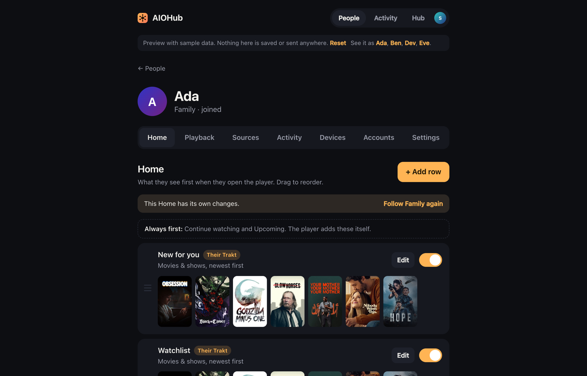

<p align="center"></p>
<h1 align="center">AIOHub</h1>
<p align="center"><b>One address for everyone you share streaming with.</b></p>
<p align="center">
  <a href="https://aiohub.miraclx.workers.dev/?sample">Try the preview</a> ·
  <a href="docs/setup.md">Set up your own</a> ·
  <a href="docs/features.md">Features</a> ·
  <a href="CHANGELOG.md">What's new</a>
</p>

You already run [AIOStreams](https://github.com/Viren070/AIOStreams) and
[AIOMetadata](https://github.com/cedya77/aiometadata) for yourself. AIOHub puts a household or a group of friends on
top of them: each person signs in to the same address from any Jellyfin player app and gets their own Home, watch
history, playback settings and devices. You manage all of it from a small website instead of one config at a time.

It is one Cloudflare Worker, and it runs on Cloudflare's Free plan.



The [preview](https://aiohub.miraclx.workers.dev/?sample) is the whole site on made-up data. Nothing is saved.

## What you get

**Each person**

- A Home of their own: rows they can rename, reorder or switch off, plus rows worked out from what they watch.
- Their own Trakt and MDBList, if they want them. Nothing is sent to either until they turn sync on.
- Sign-in that suits a TV: the TV shows a code, they approve it from their phone.
- Their own quality, languages and subtitles, and a list of their signed-in devices.

**You, the manager**

- Invite people with a link. Put them in groups such as Family or Friends.
- Set Kids or Teens limits for a person or a group.
- See who is watching what, pause someone, or sign a device out.
- Keep several debrid accounts and choose who uses which. Nobody else sees the keys.

Any Jellyfin player app works: Strand, Streamyfin, Wholphin and others. AIOHub is not a player and holds no video.

The full list is in [Features](docs/features.md).

## What you need

- A Cloudflare account. The Free plan is enough for a household; see [Cost and limits](docs/limits.md).
- A key for a debrid service (TorBox, Real-Debrid, AllDebrid, Premiumize, Debrid-Link or EasyDebrid).
- A free [TMDB](https://www.themoviedb.org/settings/api) key. A free [MDBList](https://mdblist.com/preferences/) key is
  optional and fills the rows by streaming service and by genre.
- An AIOStreams server and an AIOMetadata server. A new copy uses the public ForTheWeak servers until you point it at
  your own.

## Run your own

[](https://deploy.workers.cloudflare.com/?url=https://github.com/miraclx/aiohub)

The button copies this repository to your account, makes the database and asks for two secrets. Leave the build and
deploy commands as they are.

- `VAULT_KEY`: a long random text, 40 characters or more. It locks every key and password the site stores. Keep a copy
  and never change it.
- `CLAIM_CODE`: a code you make up. It stops a stranger from claiming your copy.

Then open `https://<your site>/#/setup/<your claim code>` and follow the steps on the page.

Prefer a terminal? It takes three commands (Node 22 or newer):

```sh
npm install
npx wrangler login
node setup.mjs
```

[Setting up](docs/setup.md) walks through both routes, the first sign-in, inviting people and turning on Trakt.

## More

- [Setting up](docs/setup.md)
- [Updating](docs/updating.md)
- [Settings](docs/configuration.md): every setting the Worker reads
- [Features](docs/features.md)
- [How it works](docs/how-it-works.md)
- [Cost and limits](docs/limits.md)
- [Working on it](docs/development.md)
- [Privacy](PRIVACY.md): what a hub keeps, and what it does with a connected Trakt or MDBList account
- [What's new](CHANGELOG.md)

## Good to know

- **Run your own copy.** A copy carries one hub: yours. The author's site is a private household hub and takes no
  sign-ups.
- **Not affiliated.** AIOHub is an independent project. It is not part of, or endorsed by, AIOStreams, AIOMetadata,
  Jellyfin, Cloudflare, MDBList, any debrid service or any player app. It uses Trakt but is not endorsed or certified
  by Trakt. This product uses the TMDB API but is not endorsed or certified by TMDB.
- **Referral links.** The "Get an account" links for TorBox and Real-Debrid in `src/data.ts` are the author's referral
  links. Change or remove them in your copy if you prefer.

## Thanks

AIOHub stands on other people's work:

- [AIOStreams](https://github.com/Viren070/AIOStreams) by Viren070, which finds the streams.
- [AIOMetadata](https://github.com/cedya77/aiometadata) by cedya77, which builds the rows, artwork and search.
- Yeb, who runs the ForTheWeak servers a new copy starts on.
- [fusion-starter-kit](https://github.com/itsrenoria/fusion-starter-kit) by itsrenoria, for the collection artwork.
- TMDB, MDBList and Trakt for the data, and Jellyfin for the protocol every player app here speaks.

## Licence

AGPL-3.0-only. See [LICENSE](LICENSE).
