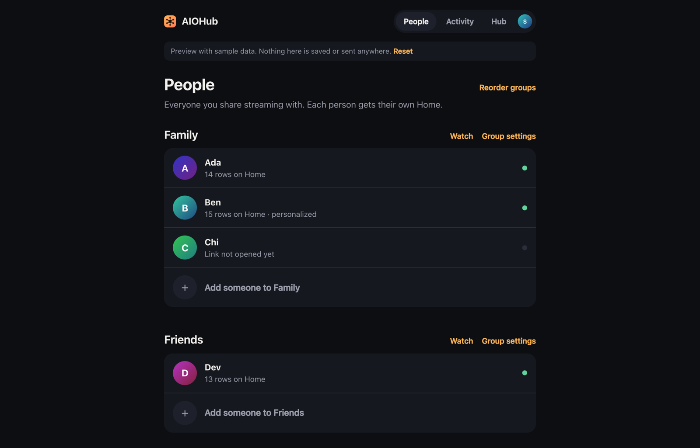
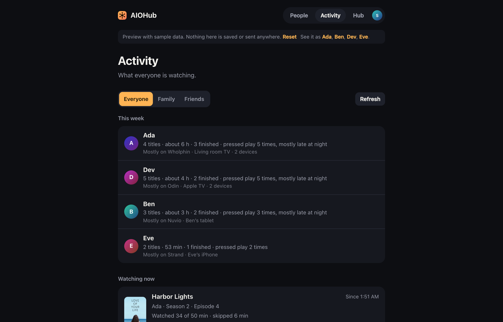

# Features

## Each person

### Home

- **Their own rows.** Trending, popular and top rated rows, collections by streaming service and by genre, and any
  list added by its link. Each row can be renamed, reordered or switched off.
- **Rows from their own watching.** A Watchlist, Recommended Movies and Recommended Shows, Recently Watched, Up Next
  (shows with a next episode out) and New for you (new episodes of shows they watch, and watchlist movies that are now
  out to stream). These work with whatever the person has. Without any account, the hub works them out from what they
  watched here. Only the Watchlist needs an account, Trakt or MDBList.
- **For you rows.** Places on Home the hub fills once a day for each person: because you watched, more films from a
  series, a show to pick back up, more from a director, their genres, something different, a seasonal set, a Top 10.
  Each pick says why it was made. A person can keep a pick, swap it for one of the day's other options, or ask never
  to be picked for from a title again.
- **Their lists.** Their own lists and the lists they liked, from Trakt and MDBList together, as rows with a tile per
  list.

### Trakt and MDBList

Both are services that keep a record of what you watch, plus watchlists and lists. A person can connect either, both
or neither.

Why connect one: it knows what you watched everywhere, not only here, so rows and recommendations start out right. It
also keeps your history in a place of your own, whatever happens to the hub.

- **Connect** only reads. It fills the person's rows and sends nothing.
- **Sync** is a switch per account, off until the person turns it on. On, what they watch here goes there as it plays,
  and what they watch elsewhere comes back.
- **Watchlist** is one more switch. On, the titles they save in the apps (the heart or Save button) and their
  watchlist are one list.

Marking something unwatched in an app, with Trakt sync on, takes its plays off Trakt too. Unwatching on Trakt's own
site does not reach the hub. [Privacy](../PRIVACY.md) has every detail of what is read and sent.

### Signing in

- **Phones and laptops:** the hub address, their name and an app password, all shown on their Devices page.
- **TVs:** Quick Connect, the Jellyfin way to sign in without typing on a remote. The TV shows a six-digit code and
  they approve it from their page.
- **In a browser:** a link on their Devices page opens a web player.

### Playback

Quality (Data saver, Balanced or Best), a size limit, audio languages, subtitles, skipping intros and credits where a
title has them marked, and hiding what they have already watched.

### Devices

Every signed-in app is listed with its name, when it was last seen and roughly where. Any of them can be renamed or
signed out.

## The manager

- **Invites.** Add a person, then send them a link or let them scan a code. They choose their own password.
- **Groups.** Put people in groups such as Family or Friends. Settings and Home rows flow from the hub to a group to a
  person, and each level can change anything for itself.
- **Content limits.** Set a person or a group to Kids or Teens. Their rows then show only titles with a rating that
  fits, and Kids get rows and folders made for children. The manager decides whether a person may change their own
  limit.
- **Activity.** Who is watching what right now, and what was watched before: how far in, which parts were played, on
  which device and from roughly where. Titles saved to a device show as downloaded.
- **Debrid accounts.** The hub can hold several, and each group or person uses the one you pick for them.
- **Control.** Pause playing for a person or a whole group (they can still browse), sign a device out, reset a
  forgotten password, and choose how stream names are labelled in the apps.
- **Background work.** Under Hub, General: every job the hub runs by itself, when each last ran and when it runs next.
- **A safe account.** Passkeys (sign in with a fingerprint or face) and one-time recovery codes for the manager.

### A call when Home changes

Optional, under Hub, General. Enter a web address, and the hub sends it one empty request after a Home change has
reached the apps, at most once every five minutes. It is there for apps that only look for new rows when told to.
Beside it you can put a page people can open to set the same thing up themselves; it shows as a link on their Devices
page.
